# ServiceBoot — Demo Guide

Step-by-step script for the OS Lab demo: setup, six demos with exact commands, what appears on screen, what each proves, a line to say, viva answers and fixes if something breaks. Any teammate can run it.

## 1. What we are showing

ServiceBoot starts several local programs (a database, a cache, an API) in dependency order, waits until each one is actually ready, and stops them all cleanly. The demo proves this in six short runs of about 1 minute each, then compares the three startup strategies with real benchmark numbers.

**Repo:** [github.com/Dhrub-Kumar-Garg/Service_boot](https://github.com/Dhrub-Kumar-Garg/Service_boot) (release tag `p3-done`). Full title: *ServiceBoot: A Dependency-Aware Local Process and Service Orchestration Tool*.

**The problem.** A developer often needs several processes running together. Starting them by hand means many terminals, remembering commands, and guessing when a dependency is ready. A process that has *started* is not necessarily *accepting connections*, so a dependent started too early fails. After a crash, leftover processes keep ports busy.

**The solution.** One YAML file (`serviceboot.yml`) lists each service's command, its dependencies and how to check it is ready. ServiceBoot builds a dependency graph from it, starts the services level by level, checks readiness over TCP or HTTP, and on stop kills each service's whole process tree, dependents first.

**Three startup strategies** (the academic comparison):

- **Sequential:** one service at a time; each waits until the previous one is ready.
- **Parallel:** every service in a dependency level starts at once; the next level starts when the whole level is ready.
- **Adaptive:** a rule picks one of the two. Parallel if graph width > 2 × depth, otherwise sequential. It is a heuristic, not an optimal choice.

**Who built what**

| Person | Owns | Main files |
| --- | --- | --- |
| Person 1 (Arushi) | YAML parsing and validation, dependency graph, cycle detection, levels, adaptive rule, mock service, sample configs | `src/config/`, `src/graph/`, `src/plan.js`, `mock/`, `samples/` |
| Person 2 (Dhrub) | The engine: spawning processes, readiness checks, the three runners, shutdown, signals, restart on failure, PID file and `down` | `src/engine/` |
| Person 3 (Rachel) | CLI and live terminal UI, CPU/memory metrics collector, `benchmark` command, charts, demo scripts, report and docs; bug fixes found while testing on Linux and Windows | `src/cli/`, `src/metrics/`, `src/benchmark/`, `scripts/`, `demos/`, `docs/` |

**Demo order:** setup (section 2), then demos 1 to 6 (sections 3 to 8). Section 9 has viva answers, section 10 has fixes if something breaks.

**What the tool looks like.** A real run on Windows (`up --config samples/small.yml --exit-after-ready`): the adaptive decision, each service starting and becoming ready in dependency order, a summary with readiness bars, then shutdown with dependents first.

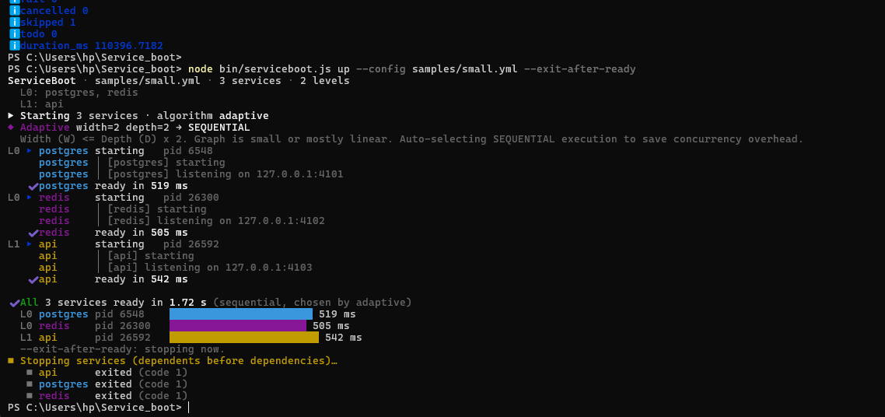

## 2. Setup before the demo

Do this once on the demo laptop, at least 15 minutes before the demo. Commands are for Windows PowerShell; the same commands work on Linux and macOS (use `/` paths).

### 2.1 Install (once)

| Tool | Version | Check with |
| --- | --- | --- |
| Node.js | 18 or newer (tested on 22) | `node -v` |
| Git | any recent | `git --version` |
| Python 3 + matplotlib | for charts and demo 5 only | `python --version`, then `pip install matplotlib` |

### 2.2 Get the code

```powershell
git clone https://github.com/Dhrub-Kumar-Garg/Service_boot.git
cd Service_boot
npm ci
```

Already cloned? Run `cd Service_boot` then `git pull` instead.

### 2.3 Confirm it works (about 3 minutes)

```powershell
npm test
npm run test:engine
```

Both must end with `fail 0`. Expected on Windows: unit `tests 194`, 4 skipped; engine `tests 34`, 1 skipped. The skips are Linux/macOS-only signal tests and are normal on Windows. Do not run anything else while `test:engine` is running; it starts real processes on fixed ports.

### 2.4 Prepare the custom config for demo 5

Run `notepad my.yml`, paste the text below, save with Ctrl+S, close Notepad. Check with `Get-Content my.yml`. Do not commit this file; it is a local demo file.

```yaml
version: 1
services:
  db:
    command: python -m http.server 8001
    ready_check: port 8001
  cache:
    command: python -m http.server 8002
    ready_check: port 8002
  api:
    command: python -m http.server 8003
    depends_on: [db, cache]
    ready_check: http http://127.0.0.1:8003/
```

If `python` is not found, use `py` in the three `command:` lines.

### 2.5 Laptop checklist (5 minutes before)

- [ ] Charger plugged in (Energy Saver slows the timings)
- [ ] Close heavy apps (Docker, extra browsers) so CPU timings stay clean
- [ ] PowerShell open in the `Service_boot` folder, maximised, text enlarged twice with Ctrl and +
- [ ] `cls` to clear the screen
- [ ] Chrome open with a blank tab (for demo 5)
- [ ] `report\charts\startup_time.png` open in another window (for demo 6)
- [ ] One full practice run of demos 1 to 6

Every command below is run from the `Service_boot` folder.

## 3. Demo 1: Plan the startup

`plan` reads a config, validates it and prints the start order, without starting anything. It is a dry run.

```powershell
node bin/serviceboot.js plan --config samples/wide.yml
```

**Expected output**

```
Config: samples/wide.yml  (10 services)
Start order (levels):
  Level 0: w1, w2, w3, w4, w5, w6, w7, w8
  Level 1: api1, api2
Graph analysis: depth=2 width=8
Adaptive decision: PARALLEL
Width (W) > Depth (D) x 2. High independent concurrency detected. Auto-selecting PARALLEL execution.
```

The same output as a screenshot (top: `wide.yml`, parallel; bottom: `linear.yml`, sequential):

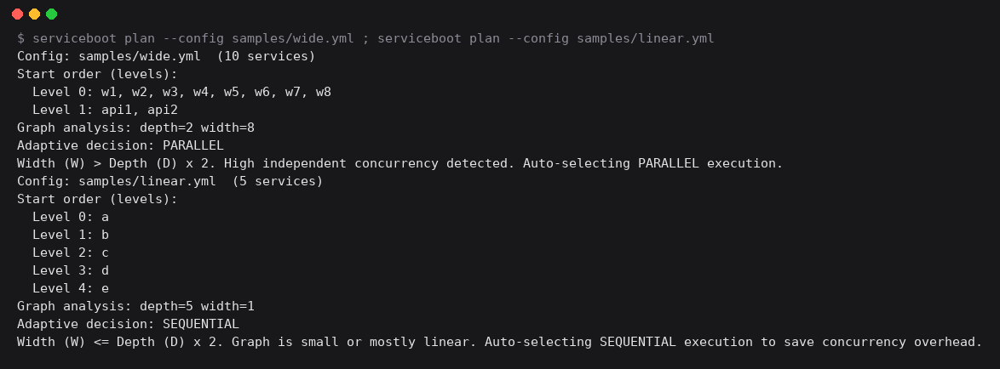

**What happens inside**

1. The YAML is parsed and validated (Person 1, `src/config/`). Every problem is reported at once, not just the first.
2. A dependency graph (a DAG) is built, and cycles are rejected with their path (`src/graph/dag.js`).
3. Services are grouped into levels: level 0 has no dependencies; a service's level is 1 + the highest level of its dependencies (`src/graph/topo.js`).
4. Adaptive rule: width = largest level (8), depth = number of levels (2). 8 > 2 × 2, so it chooses parallel (`src/graph/adaptive.js`).

**Optional contrast** (10 seconds): `node bin/serviceboot.js plan --config samples/linear.yml` shows 5 levels of 1 service each, so adaptive picks SEQUENTIAL. `samples/cyclic.yml` is rejected with exit code 1 and the path `a -> b -> c -> a`.

> **Say:** "`plan` reads the YAML, builds the dependency graph and splits it into levels. Eight services have no dependencies, so the graph is wide and adaptive picks parallel. On a chain it would pick sequential."

## 4. Demo 2: Sequential vs parallel race

This is the main result. The same 10 services start about 5× faster with parallel than with sequential: about 9 s vs 2 s.

```powershell
node bin/serviceboot.js up --config samples/wide.yml --algorithm sequential --exit-after-ready --quiet
node bin/serviceboot.js up --config samples/wide.yml --algorithm parallel --exit-after-ready --quiet
```

**What the flags mean**

| Part | Meaning |
| --- | --- |
| `up` | Actually start the services (unlike `plan`) |
| `--algorithm sequential` / `parallel` | Force a strategy instead of the adaptive choice |
| `--exit-after-ready` | Measure startup, then stop everything and exit by itself |
| `--quiet` | Hide each service's own log lines so the screen stays readable |

**What you will see**

- **Sequential:** w1 starting, w1 ready, w2 starting, w2 ready, and so on, one at a time. The summary says `All 10 services ready in ~9 s`.
- **Parallel:** eight `starting` lines appear together, then eight `ready` lines, then api1 and api2 start. The summary says `~1.6 to 2 s`.
- In both, **api1 and api2 start only after every w service is ready**. That is the dependency barrier.
- The coloured bars show each service's readiness time. The stop lines list the dependents first (api1, api2), then the w services.

**Parallel run on Windows:** all eight w services start together, api1 and api2 start only after the last w is ready, and everything is ready in 1.93 s.

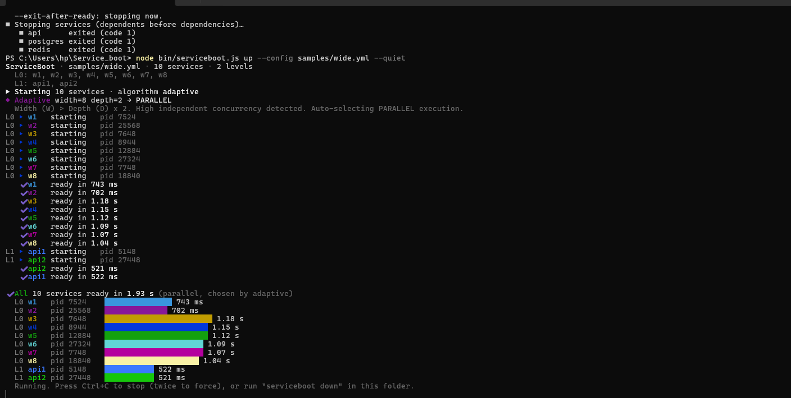

Measured on a Windows laptop: about 1.9 s for parallel. Benchmark mean on Linux: 9089 ms sequential vs 1592 ms parallel (section 8).

**Why each w service takes about 1 s when its delay is 0.5 s:** readiness is checked every 500 ms. The first check lands just before the mock opens its port, so the second check succeeds. Measured times move in 0.5 s steps.

**On Windows,** stop lines say `exited (code 1)`. Windows has no graceful SIGTERM, so ServiceBoot force-stops the process tree with `taskkill /T /F`, and Windows reports code 1. On Linux the same lines say `(signal SIGTERM)`.

> **Say:** "Sequential starts one service at a time and takes about 9 seconds. Parallel starts every independent service together and takes about 2. The two API services still wait for all their dependencies, so the order is never broken."

## 5. Demo 3: Live run and Ctrl+C shutdown

Without `--exit-after-ready`, the services keep running until you stop them. Ctrl+C stops them dependents-first, kills each whole process tree, and exits with code 130.

```powershell
node bin/serviceboot.js up --config samples/wide.yml --quiet
```

1. Wait for `All 10 services ready` and `Running. Press Ctrl+C to stop (twice to force)...`.
2. Press **Ctrl+C once**. You see `Stopping services (dependents before dependencies)...`, then 10 `exited` lines: api1 and api2 first, then w1 to w8.
3. Check the exit code:

    ```powershell
    $LASTEXITCODE
    ```

    It prints **130** (the standard code for "stopped by Ctrl+C").
4. Prove nothing was left behind:

    ```powershell
    Get-CimInstance Win32_Process -Filter "Name='node.exe'" | Where-Object CommandLine -like '*mock-service*' | Select ProcessId,CommandLine
    Test-Path .serviceboot/pids.json
    ```

    Expected: no rows, then `False`.

**Ctrl+C once, on Windows:** api1 and api2 exit first, then the eight w services; `$LASTEXITCODE` prints 130.

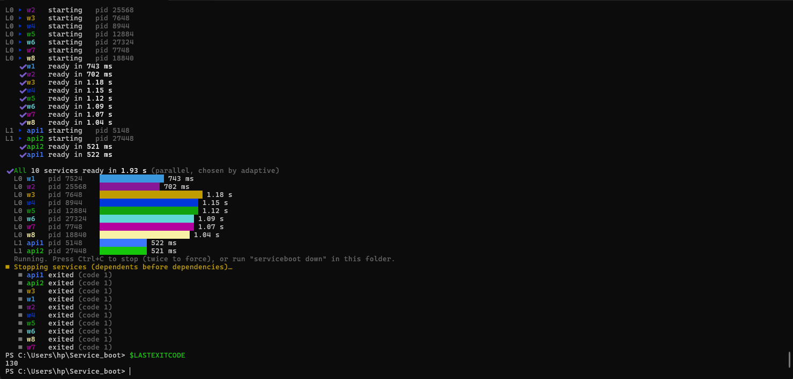

**Optional: force stop.** Run the same `up` again and press Ctrl+C **twice quickly**. It skips the graceful wait, kills everything at once, and still exits 130 with no leftovers.

**Ctrl+C twice, then the orphan check:** exit code 130, the process query returns no rows, and `Test-Path .serviceboot/pids.json` prints `False`.

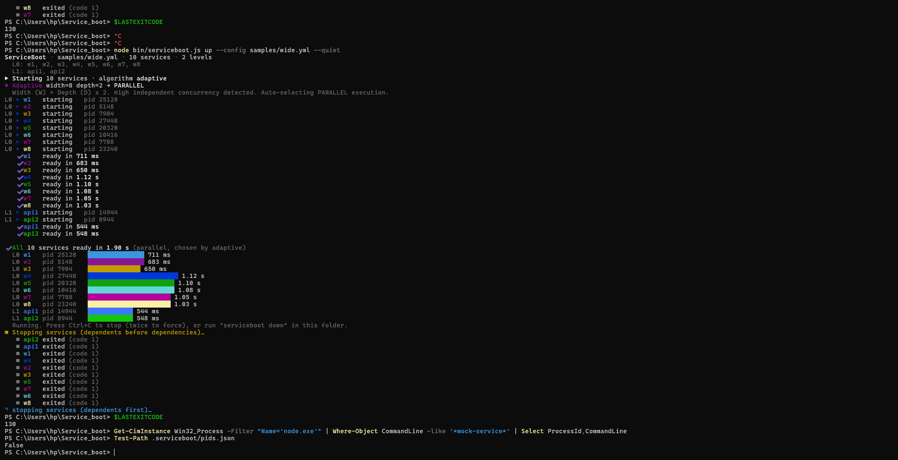

**Why it works**

- Each service runs as a shell plus its children. ServiceBoot stops the whole **process tree**, not just the PID it started, otherwise grandchildren would be left as orphans (`src/engine/process-manager.js`).
- Shutdown goes in **reverse dependency order**: the deepest level stops completely before the next one (`stopAll` in `src/engine/index.js`).
- `up` records every PID in `.serviceboot/pids.json` and deletes the file after a clean stop. If the CLI is killed hard, `node bin/serviceboot.js down` reads that file and stops the orphans.

> **Say:** "Ctrl+C stops the APIs before the services they depend on, kills each service's whole process tree, and exits 130. The check shows zero leftover processes."

## 6. Demo 4: Crash recovery

A service that crashes is restarted up to its retry limit, then left down, while its healthy neighbour keeps running.

```powershell
node bin/serviceboot.js up --config samples/restart.yml --quiet
```

`samples/restart.yml` has two services. `crashing` exits with code 1 about 1.5 s after it starts and has `restart: on-failure` with `max_retries: 2`. `healthy` is a normal service.

**What you will see (about 8 seconds)**

1. Both services ready.
2. `crashing exited (code 1)`, then `restarting (attempt 1/2) ... backoff 500 ms`, then ready again.
3. `crashing exited (code 1)`, then `restarting (attempt 2/2) ... backoff 1.00 s`, then ready again.
4. `crashing exited (code 1)`, then `crashing failed (crash): exited with code 1 after becoming ready`. The retry budget is used up.
5. `healthy` was never touched. Press **Ctrl+C** to stop it.

**Real run on Windows:** two restarts with 500 ms then 1.00 s back-off, then `crashing failed (crash)` once the budget is used up. `healthy` stays ready throughout.

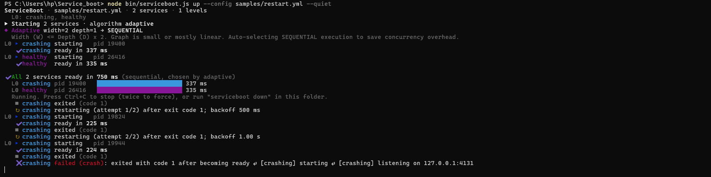

**The rules** (`src/engine/recovery.js`)

- Back-off between retries = 500 ms × attempt number, so 500 ms, then 1 s. This prevents a tight crash loop.
- `max_retries` is a budget for the whole run, so it can never restart forever.
- A clean exit with code 0 is not restarted.
- Services that depend on a crashed one are not restarted (a known limitation).

> **Say:** "This service crashes on purpose. ServiceBoot restarts it twice with an increasing delay, then gives up so it can't loop forever. The healthy service keeps running the whole time."

## 7. Demo 5: Your own config, real servers

ServiceBoot is not hardcoded to the samples. It runs any service described in any YAML file. Here it starts three real Python web servers from `my.yml` (prepared in section 2.4).

### 7.1 Plan and start

```powershell
node bin/serviceboot.js plan --config my.yml
node bin/serviceboot.js up --config my.yml
```

- `plan` shows `Level 0: db, cache` and `Level 1: api`, with adaptive choosing SEQUENTIAL (width 2 is not greater than 2 × 2).
- `up` starts db, then cache, then api. The first `api | ... "GET / HTTP/1.1" 200` line is ServiceBoot's own HTTP readiness check asking the server "are you up?".

**`Get-Content my.yml` and `plan`:** the file as saved, then levels `db, cache` and `api`, with adaptive choosing SEQUENTIAL.

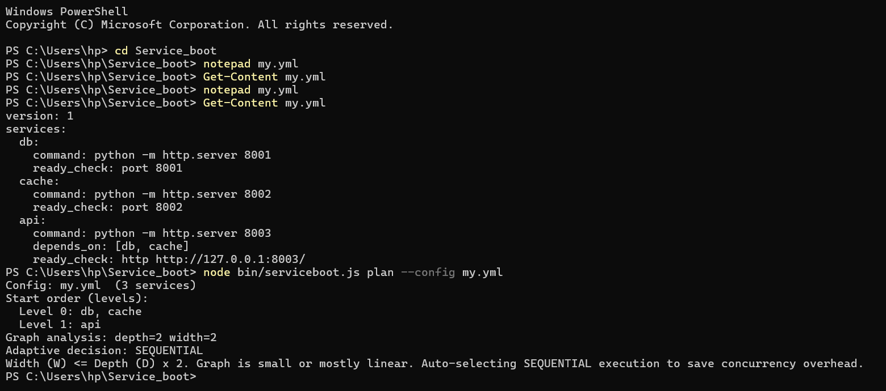

**`up`:** db, then cache, then api. The first `GET / 200` under api is ServiceBoot's readiness check; the later lines are the browser's requests.

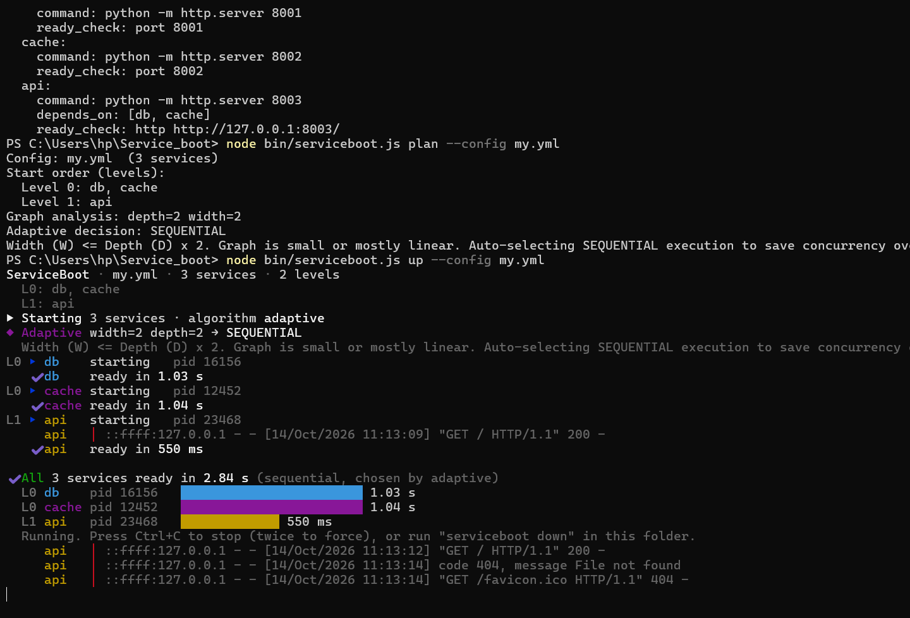

### 7.2 Prove the server is real

While it runs, open **http://127.0.0.1:8003** in Chrome. A directory listing appears, and new `GET /` lines show in PowerShell. Those are the browser's requests. A `favicon.ico 404` line is the browser asking for a tab icon, and is normal.

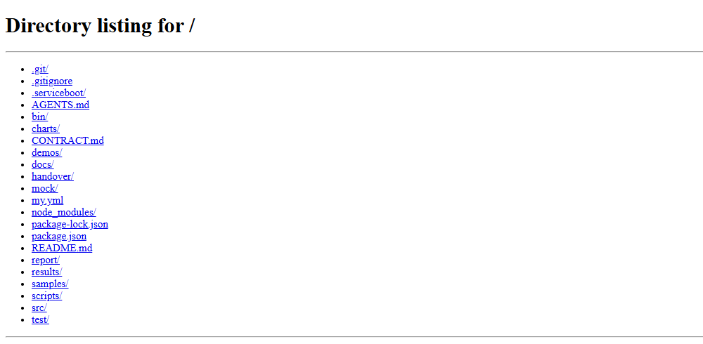

Press **Ctrl+C** in PowerShell. Refresh the browser: the page can no longer be reached, so the servers really stopped.

### 7.3 Optional: parallel on the same file

```powershell
node bin/serviceboot.js up --config my.yml --algorithm parallel --exit-after-ready
```

db and cache now start at the same moment. Measured on the laptop: 2.84 s sequential vs 2.38 s parallel. The saving is smaller than one full second because readiness is polled every 500 ms.

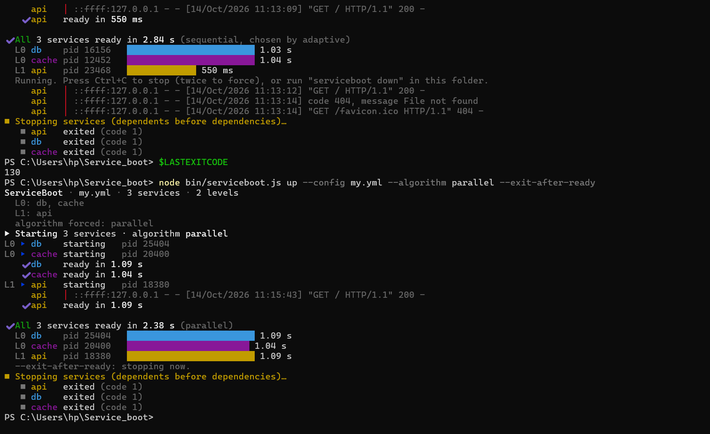

### 7.4 Bad input is rejected

In Notepad, change `depends_on: [db, cache]` to `depends_on: [db, missing]`, save, then:

```powershell
node bin/serviceboot.js plan --config my.yml
$LASTEXITCODE
```

Expected: `error: Service "api" depends on unknown service "missing"` and exit code **1**. Nothing starts. Change it back to `[db, cache]` afterwards.

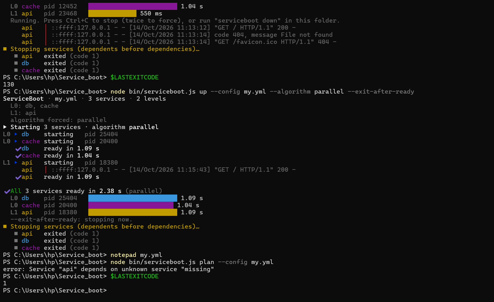

### 7.5 What a config can contain

- **Any names:** letters, digits, `-` and `_` (`frontend`, `auth-service`, `worker_2`).
- **Any number** of services and any dependency shape (chain, diamond, wide).
- **Any command** that runs on the machine: `python app.py`, `npm start`, `node server.js`, a real `redis-server`.
- Rejected: unknown or self dependencies, cycles, two services checking the same port, a missing `command`.

> **Say:** "It isn't hardcoded. This is my own config with three real Python servers, and the browser is talking to one of them. A typo in a dependency is caught before anything starts."

## 8. Demo 6: Benchmark results

Parallel cut startup of the wide graph from 9.09 s to 1.59 s (5.7× faster), gave no gain on the linear chain, and was 1.6× faster on the small graph, where the adaptive rule chose sequential.

**What to show:** open `report/charts/startup_time.png`. Do not rerun the benchmark live; 5 runs take about 2.5 minutes.


*Source: `report/results.json` · `serviceboot benchmark --runs 5` · Linux VM, 2 logical CPUs, Node 22 · 45 runs, all successful.*

**How to read it**

- **Wide (8 independent + 2 dependents):** parallel overlaps the eight startups, so it wins by far. Adaptive correctly chose parallel and matched it.
- **Linear chain (5 in a row):** every level holds one service, so there is nothing to overlap. All three strategies take the same time.
- **Small (2 independent + 1 dependent):** parallel overlaps postgres and redis. Adaptive's rule (width 2 > 2 × depth 2 is false) picked sequential and lost about 0.5 s, so the heuristic is not optimal.
- **Peak memory is the same for every strategy** (about 483 MB on wide): the same processes end up running either way; the order only changes *when* memory is used.
- **Parallel causes more CPU contention:** on wide, involuntary context switches went from 42 to 134 per run, because 8 processes started at once on 2 cores.

**Per-service readiness** (`report/charts/per_service_ready.png`): each service's own spawn-to-ready time. Under parallel on wide, the first w services take slightly longer than the last, because eight processes compete for two CPU cores.


> **Say:** "These are measured, not estimated: five serial runs per bar. Parallel was 5.7 times faster on the wide graph and made no difference on a chain. Our adaptive rule is a heuristic, and on the small graph it actually chose the slower option."

## 9. Viva questions and answers

Each answer is what the code actually does. The full mapping of OS concept to file and function is in [`docs/OS_CONCEPTS.md`](docs/OS_CONCEPTS.md).

### OS concepts

| Question | Answer |
| --- | --- |
| Which OS concepts does it use? | Process creation, process groups and trees, signals (SIGTERM, then SIGKILL), TCP sockets and HTTP for readiness, pipes for service output, synchronization by level barriers, a DAG with topological levels, CPU and memory accounting. |
| How is a service started? | Node's `child_process.spawn` runs the command through a shell (`/bin/sh` or `cmd.exe`). On Linux it becomes the leader of a new process group. |
| Why not just kill the PID you started? | That PID is only the shell. The real program is its child, and it may have grandchildren. Killing the shell alone leaves orphans holding ports, so the whole group or tree is stopped. |
| SIGTERM vs SIGKILL? | SIGTERM asks a process to clean up and exit; it can be caught. After a grace period SIGKILL is sent; it cannot be caught or ignored. |
| And on Windows? | Windows has no deliverable SIGTERM, so ServiceBoot uses `taskkill /T /F` on the tree. That is why stop lines show `code 1` there. |
| What does "ready" mean? | `port N` = a TCP connection to 127.0.0.1:N succeeds. `http URL` = the URL returns a 2xx status. `none` = the process spawned. Starting is not the same as ready. |
| What synchronization is there? | In parallel mode a level barrier: the next level starts only when every service in the current level is ready. Shutdown has the reverse barrier. These are asynchronous Promises, not mutexes or semaphores. |
| What is a zombie? | A process that has exited but whose parent has not collected its exit status. It still has a PID. On Linux this made shutdown wait out its full timeout until it was fixed. |
| Is this CPU scheduling like FCFS or Round Robin? | No. These are service-startup orders on a dependency graph, not CPU scheduling algorithms. |

### Design and results

| Question | Answer |
| --- | --- |
| Is parallel always faster? | Only when services are independent. On a chain (`linear.yml`) there is nothing to overlap, so both take the same time. With heavy CPU-bound services, parallel can contend for the CPU; `--max-parallel N` limits that. |
| Is adaptive optimal? | No. It is a fixed rule (width > 2 × depth). On `small.yml` it chose sequential, which was about 0.5 s (33%) slower than parallel. |
| Why do times come in 0.5 s steps? | Readiness is polled every 500 ms (`ready_interval_ms`). A service that opens its port just after a check is seen at the next one. |
| How are CPU and memory measured? | Every 500 ms the collector takes one snapshot of the process table, walks each service's whole tree, and sums the members. CPU% = CPU-time used ÷ wall time × 100, where 100% = one busy core. Memory = resident set size (RSS). |
| Why repeat benchmark runs? | Timings vary from run to run. Runs are serial and round-robin, every run is fully stopped before the next, and the report shows mean, spread and min to max. |
| What happens if a service crashes during startup? | The run fails with exit code 3 and everything already started is stopped, dependents first. Nothing is left running. |
| What if the CLI is killed with kill -9? | `serviceboot down` in the same folder reads `.serviceboot/pids.json` and stops the orphaned services. |
| How is it different from Docker Compose? | Compose coordinates containers. ServiceBoot coordinates native processes on the host, for developers who don't want to containerise everything. It is not a production orchestrator. |

### What Person 3 did

- Built the CLI and live terminal UI (`src/cli/`), with plain machine-readable output when piped.
- Built the metrics collector for whole process trees (`src/metrics/`) and the serial `benchmark` command (`src/benchmark/`).
- Wrote the chart script, the demo scripts, the report and docs.
- Fixed bugs found by testing on Linux and Windows: a readiness diagnostic, a mock signal race, zombies after a forced stop, a Windows PID-file lock, and slow Windows sampling.

**Known limitations to state openly:** dependents are not restarted after a dependency crash; `down` trusts the PID file, so a recycled PID in a very old stale file could be signalled; there are no CPU or memory caps on services; Windows CPU sampling is coarse because each sample starts PowerShell.

## 10. Troubleshooting and reference

### If something goes wrong during the demo

First move, always: `node bin/serviceboot.js down`. It stops anything a previous run left behind. Then rerun the command.

| You see | Cause | Fix |
| --- | --- | --- |
| `Port 4101 is already in use` | A previous run or another program still holds the port | `node bin/serviceboot.js down`, then retry |
| `ServiceBoot is already running (pid X)` | Another `up` is live in this folder | Stop it with Ctrl+C in its window, or run `down` |
| `warning: stale ServiceBoot pid file` | The last run was killed hard | Nothing; it cleans up and continues |
| Timings much slower than expected | Battery saver or heavy apps running | Plug in the charger, close apps, run again |
| Symbols show as `?` or boxes | Old Windows console | Use Windows Terminal, or add `--no-color` |
| `python` not found (demo 5) | Python is not on PATH | Use `py` in `my.yml`'s commands |
| `my.yml` prints nothing | Notepad did not save | Reopen with `notepad my.yml`, paste, Ctrl+S |

### Commands

| Command | What it does |
| --- | --- |
| `node bin/serviceboot.js plan --config F [--json]` | Validate the config, print levels and the adaptive decision. Starts nothing. |
| `node bin/serviceboot.js up --config F` | Start everything and keep it running. Ctrl+C stops it; twice forces. |
| `... up ... --algorithm sequential\|parallel\|adaptive` | Choose the strategy (default adaptive) |
| `... up ... --max-parallel N` | At most N services starting at once within a level |
| `... up ... --exit-after-ready` | Measure startup, then stop and exit |
| `... up ... --plain` / `--quiet` / `--no-color` | One `event key=value` line per event / hide service logs / no colours or spinner |
| `node bin/serviceboot.js down` | Stop the run recorded in this folder, including after a hard kill |
| `node bin/serviceboot.js benchmark --runs N` | Run every strategy on small, linear and wide, N times each; writes `results/results.json` |
| `python scripts/charts.py results/results.json --out charts` | Draw the charts from a benchmark file |
| `node bin/serviceboot.js --help` | Full usage |

### Exit codes

| Code | Meaning |
| --- | --- |
| 0 | Success |
| 1 | Config error: invalid YAML, unknown dependency, cycle |
| 2 | Usage error: wrong command or flag |
| 3 | Runtime failure: a service crashed, timed out, or a port was busy |
| 130 | Stopped by Ctrl+C |
| 143 | Stopped by SIGTERM (Linux/macOS) |

### Config keys

| Key | Meaning | Default |
| --- | --- | --- |
| `command` | Shell command to run (required) | none |
| `cwd` | Working folder, relative to the config file | the config's folder |
| `env` | Extra environment variables | none |
| `depends_on` | Services that must be ready first | none |
| `ready_check` | `port N`, `http URL` or `none` | `none` |
| `ready_timeout_ms` / `ready_interval_ms` | Readiness deadline / polling interval | 30000 / 500 |
| `restart` / `max_retries` | `on-failure` restarts crashes, up to the limit for the whole run | `never` / 3 |
