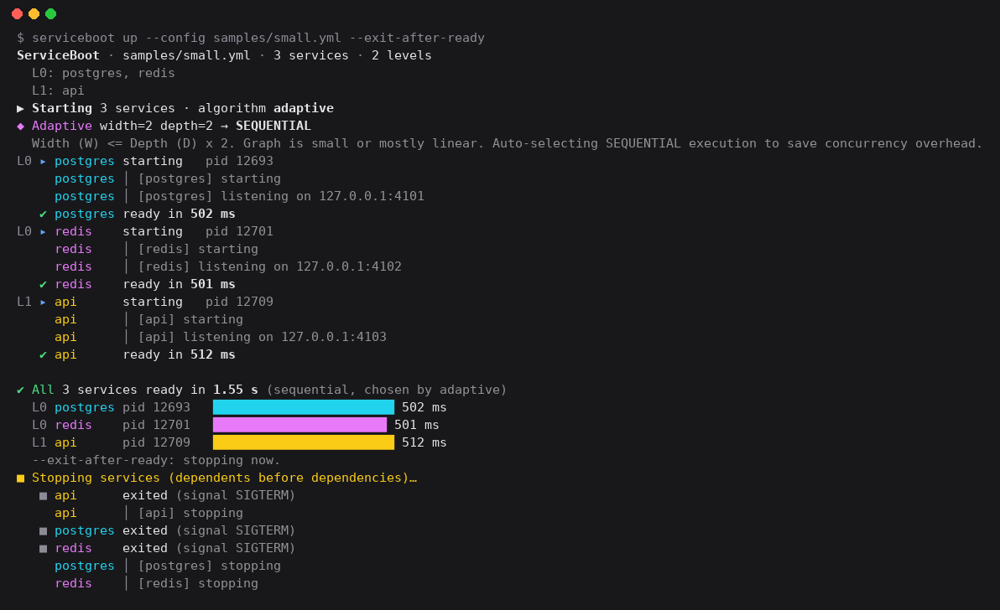
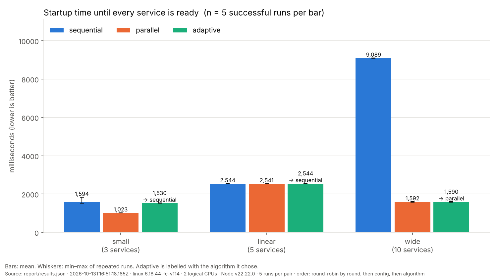

# ServiceBoot

**A dependency-aware orchestrator for native local development processes.**
Describe your services and their dependencies in one YAML file; ServiceBoot
starts them in dependency order, waits until each one is actually *ready*
(TCP port or HTTP health check), shows what is happening, restarts crashed
services if asked, and stops everything cleanly — no containers required.

Built as an OS Lab project: process groups, signals, readiness over sockets,
dependency-graph scheduling and a measured comparison of three startup strategies.



## Problem

Multi-process local development (database + cache + API + worker) means
several terminals, remembered commands and guessing when a dependency is ready.
A process that has *started* is not necessarily *accepting connections*, so a
dependent started too early fails. When something crashes, orphaned processes
keep ports busy.

## Solution

```yaml
# serviceboot.yml
version: 1
services:
  postgres:
    command: postgres -D ./data
    ready_check: port 5432
  redis:
    command: redis-server --port 6379
    ready_check: port 6379
  api:
    command: npm start
    cwd: ./api
    depends_on: [postgres, redis]
    env: { DATABASE_URL: "postgres://localhost:5432/dev" }
    ready_check: http http://127.0.0.1:3000/health
    restart: on-failure
    max_retries: 3
```

```sh
serviceboot up        # postgres + redis start together, api starts when both are ready
serviceboot down      # stop everything this folder started (also after a crash)
```

The commands in your config (`postgres`, `redis-server`, ...) must already be
installed; ServiceBoot runs them, it does not install them. Every sample in
`samples/` uses the bundled `mock/mock-service.js`, so the demos need only Node.

**Presenting or running the demo?** Follow the step-by-step [Demo Guide](DEMO_GUIDE.md): setup, six demos with exact commands and real screenshots, viva answers and troubleshooting.

## Quick start

Requires Node.js 18+ (verified on 22). Python 3 + matplotlib only for charts.

```sh
npm install
node bin/serviceboot.js plan --config samples/wide.yml
node bin/serviceboot.js up   --config samples/small.yml          # Ctrl+C to stop
node bin/serviceboot.js up   --config samples/wide.yml --exit-after-ready
node bin/serviceboot.js down
node bin/serviceboot.js benchmark --runs 3                       # -> results/results.json
python3 -m pip install -r scripts/requirements.txt
python3 scripts/charts.py results/results.json --out charts      # -> charts/*.png
```

`npm link` (or `npm install -g .`) puts `serviceboot` on your PATH.

## Commands

| Command | What it does |
|---|---|
| `serviceboot plan [--config F] [--json]` | Validate, print dependency levels, graph width/depth and the adaptive decision. |
| `serviceboot up [--config F] [--algorithm A] [--max-parallel N] [--exit-after-ready] [--plain] [--quiet] [--no-color]` | Start everything and keep it running. Ctrl+C stops (twice forces). |
| `serviceboot down` | Stop the run recorded in `./.serviceboot/pids.json` — a live `up`, or the orphans of a killed one. Run it in the same folder as `up`. |
| `serviceboot benchmark [--config F]... [--runs N] [--algorithms LIST] [--max-parallel N] [--out F] [--sample-ms N] [--no-metrics]` | Run every algorithm on every config, serially, N times each; write results JSON and print a summary. |

**Algorithms** (`--algorithm`, default `adaptive`):

- `sequential` — one service at a time; each waits until the previous one is ready.
- `parallel` — every service of a dependency level at once; the next level starts when the whole level is ready. `--max-parallel N` caps how many may be starting at the same time.
- `adaptive` — parallel if graph width > 2 × depth, otherwise sequential. A heuristic: see the [report](docs/REPORT.md#63-analysis) for where it is wrong.

**Output.** On a terminal you get the live UI (colours, spinner, per-service
readiness bars). When output is piped, redirected or `--plain` is given, you get
one machine-readable line per event (`service:ready api pid=… ms=…`). `NO_COLOR`
or `--no-color` turn colours off; `--quiet` hides service output.

**Exit codes:** 0 ok · 1 config error · 2 usage error · 3 runtime failure
(a service failed, port busy, cleanup error) · 130 Ctrl+C · 143 SIGTERM.

### Config reference

| Key | Meaning |
|---|---|
| `command` | Shell command (required). Runs through `/bin/sh` or `cmd.exe`. |
| `cwd` | Working directory, relative to the config file. |
| `env` | Extra environment variables. |
| `depends_on` | Services that must be **ready** first. Unknown names and cycles are rejected. |
| `ready_check` | `port N` (TCP connect to 127.0.0.1:N) · `http URL` (2xx) · `none` (ready once spawned, default) |
| `ready_timeout_ms` / `ready_interval_ms` | Readiness deadline (30000) and polling interval (500). |
| `restart` / `max_retries` | `on-failure` restarts nonzero exits/crashes with back-off 500 ms × attempt, up to `max_retries` (3) for the whole run. |

## Features (implemented and tested)

- YAML validation reporting **all** problems; cycle detection with the path.
- Dependency levels, three startup algorithms, `--max-parallel` startup limit.
- TCP / HTTP / HTTPS readiness with timeouts; busy-port check before start.
- Process groups and full process-tree shutdown in reverse dependency order,
  SIGTERM → SIGKILL (POSIX) or `taskkill /T /F` (Windows).
- First-failure cleanup: a crash during startup stops everything already started.
- `restart: on-failure` with bounded retries.
- PID file + `down` recovers orphans after `kill -9`.
- Terminal UI and plain event output.
- CPU / memory / (Linux) context-switch sampling over whole service process trees.
- Serial, round-robin benchmark with versioned results JSON; matplotlib charts.

## Results (measured)

Linux, 2 logical CPUs, Node 22, 5 runs per cell (`report/results.json`):

| Config | Sequential | Parallel | Adaptive (chose) |
|---|---|---|---|
| small (3 services) | 1594 ms | **1023 ms** | 1530 ms (sequential) |
| linear chain (5) | 2544 ms | 2541 ms | 2544 ms (sequential) |
| wide (10) | 9089 ms | **1592 ms** | 1590 ms (parallel) |

Parallel was 5.7× faster on the wide graph, equal on the chain, and 1.6× faster
on the small graph, where the adaptive rule picked sequential. Full analysis,
memory/CPU/context-switch results and threats to validity:
**[docs/REPORT.md](docs/REPORT.md)**.



## Limitations

- Verified on Linux (this release) and Windows (engine, by Person 2). macOS and
  the Windows metrics/PowerShell-demo code paths have not been run.
- Dependents are not restarted when a dependency crashes after readiness.
- `down` trusts the PID file; a recycled PID from an old stale file could be signalled.
- No CPU/memory caps on services (`--max-parallel` limits concurrent startups only).
- In a container without an init process (no zombie reaping), stopping waits
  for the full grace period and can time out. Use `docker run --init`.

## Compared with container tools

Docker Compose starts containers and has `depends_on` with health conditions.
ServiceBoot does the equivalent for processes that run directly on your machine,
when you do not want to containerise your development setup. It is not a
production supervisor or orchestrator.

## Repository map

| Path | Contents |
|---|---|
| `bin/`, `src/cli/` | CLI entry, argument parsing, terminal UI (`ui.js`), signal handling |
| `src/config/`, `src/graph/`, `src/plan.js` | YAML parsing/validation, DAG, levels, adaptive analysis (Person 1) |
| `src/engine/` | Process manager, readiness, runners, shutdown, restart, PID file, `down` (Person 2) |
| `src/metrics/` | CPU/memory/context-switch collector (Person 3) |
| `src/benchmark/` | Benchmark runner and statistics (Person 3) |
| `scripts/` | `charts.py`, `render_terminal.py`, `requirements.txt` |
| `demos/` | `demo.sh` (Linux/macOS), `demo.ps1` (Windows), recorded transcripts |
| `samples/`, `mock/` | Example configs and the mock service |
| `report/` | Benchmark results JSON, charts, screenshots and their raw recordings |
| `DEMO_GUIDE.md`, `demo-images/` | Step-by-step [demo guide](DEMO_GUIDE.md) with real screenshots |
| `docs/` | [Report](docs/REPORT.md), [OS concepts → code](docs/OS_CONCEPTS.md), [engine notes](docs/ENGINE.md) |
| `CONTRACT.md`, `handover/` | Shared interfaces and team handovers |

## Tests

```sh
npm test               # unit tests (fast)
npm run test:engine    # real processes: ordering, signals, orphans, restart, benchmark
./demos/demo.sh        # every scenario, with an orphan check after each
```
