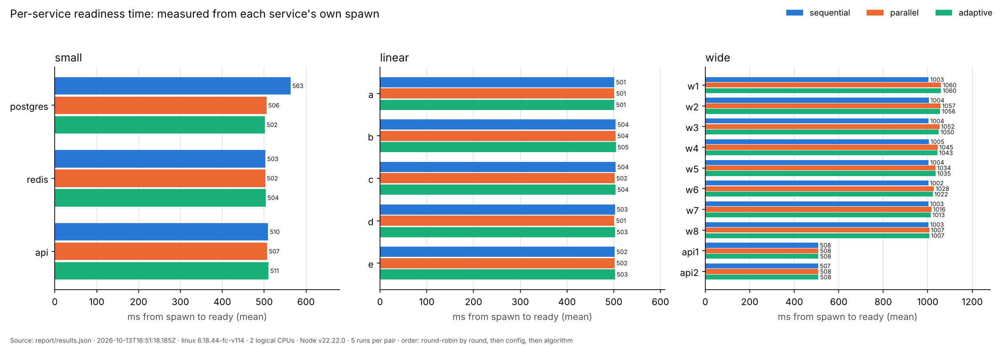
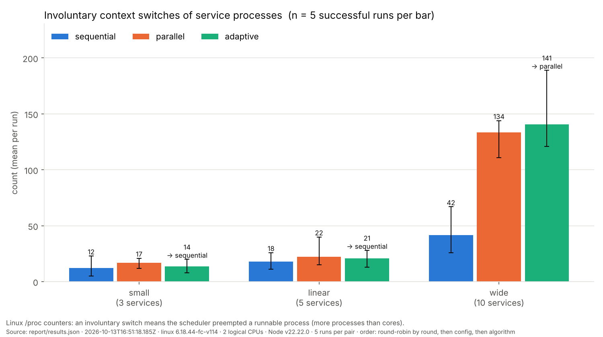

# ServiceBoot: A Dependency-Aware Local Process and Service Orchestration Tool

**Final report — OS Lab project**

All numbers in this report come from `report/results.json`, produced by
`serviceboot benchmark --runs 5` on the machine described in §6.1. Charts in
`report/charts/` were drawn from that same file by `scripts/charts.py`.
Screenshots in `report/screenshots/` are rendered from real terminal recordings
(`report/screenshots/raw/*.typescript`) by `scripts/render_terminal.py`.

---

## 1. Problem

A local development environment often needs several independent processes: a
database, a cache, an API, a worker. They must start in dependency order, and a
process that has *started* is not necessarily *ready* (accepting connections).
Doing this by hand means several terminals, remembered commands, guessing when
something is ready, and orphaned processes after a crash.

**Question:** how can a developer declare dependencies among native processes
once, then start, monitor and stop them in a coordinated, repeatable way — and
which startup strategy is fastest for which dependency graph?

**Scope.** Native host processes for local development. ServiceBoot does not
replace Docker Compose, Kubernetes or a production supervisor; it targets
developers who do not want to containerise their whole development setup.

## 2. Solution overview

```
serviceboot.yml ──► parser + validator ──► DAG + cycle check ──► dependency levels
                                                                     │
                     adaptive analyzer (width vs depth) ◄────────────┤
                                                                     ▼
                         engine: sequential | parallel (worker pool, --max-parallel)
                                    │ spawn (process groups) │ readiness (TCP/HTTP)
                                    ▼                        ▼
                     events ──► terminal UI / plain lines / PID file / metrics collector
                                    │
                     stopAll: reverse levels, SIGTERM → SIGKILL (taskkill on Windows)
```

| Command | Purpose |
|---|---|
| `serviceboot plan` | validate, print levels and the adaptive decision |
| `serviceboot up` | start everything in order and keep it running |
| `serviceboot down` | stop the run recorded in `.serviceboot/pids.json` (also after a hard kill) |
| `serviceboot benchmark` | compare all algorithms on several configs, write results JSON |

Team split (see `handover/`): Person 1 — config, graph, adaptive analyzer, mock
service, samples, contract tests. Person 2 — the OS engine (process groups,
readiness, three runners, failure cleanup, signals, restart, `down`).
Person 3 — CLI/terminal UI, metrics collector, benchmark, charts, demos, docs,
this report.

## 3. Dependency graph and startup strategies

**Levels.** `level(s) = 0` with no dependencies, else `1 + max(level of deps)`
(Kahn-style). Cycles are rejected with the cycle path, e.g.
`Circular dependency detected: a -> b -> c -> a`.

**Sequential.** Flatten the levels; start one service; wait until it is ready;
start the next. Simple, minimal concurrent load, but independent services wait
for each other.

**Parallel.** Start every service in a level concurrently (a worker pool of
size `--max-parallel`, default unlimited), wait until *all* of them are ready
(level barrier), then move to the next level.

**Adaptive.** `depth` = number of levels, `width` = size of the largest level.
If `width > 2 × depth` choose parallel, otherwise sequential. This is a
heuristic, not a guarantee (see §6.3: it is wrong for `small.yml`).

**Readiness.** `port N` = a TCP connection to 127.0.0.1:N succeeds;
`http URL` = an HTTP 2xx; `none` = spawned. Each check is polled every
`ready_interval_ms` (default 500) until `ready_timeout_ms` (default 30000).

## 4. OS mechanisms

The full concept → file/function table is in [`docs/OS_CONCEPTS.md`](OS_CONCEPTS.md).
Short version:

- **Process creation and groups.** Each service is a shell child started with
  `detached: true`, making it the leader of a new POSIX process group, so one
  signal to `-pid` reaches the shell, the service and its grandchildren.
- **Signals.** Graceful stop = `SIGTERM` to the group, a grace period, then
  `SIGKILL`. `SIGINT` (Ctrl+C) exits 130, `SIGTERM` exits 143, a second Ctrl+C
  kills synchronously. Windows has no deliverable SIGTERM → `taskkill /T /F`.
- **Synchronization.** Level barriers in parallel startup; the reverse barrier
  in shutdown (dependents stop completely before their dependencies); a shared
  abort signal cancels all readiness waits on the first failure.
- **IPC.** TCP sockets and HTTP for readiness; pipes for service stdout/stderr.
- **Resource limit.** `--max-parallel N` caps concurrent *startups* per level.
- **Fault recovery.** `restart: on-failure`, back-off 500 ms × attempt, lifetime
  retry budget; startup crash → everything already started is torn down.
- **Orphan recovery.** Atomic PID file; `down` stops orphaned process groups
  after the CLI is killed with `SIGKILL`.
- **Accounting.** CPU time and RSS per process from `/proc` (Linux), `ps`
  (macOS), CIM (Windows); context-switch counters from `/proc` (Linux).

## 5. Metric definitions

| Metric | Definition |
|---|---|
| startup time | engine `totalMs`: from `run:start` until every service passed its readiness check (monotonic clock) |
| per-service ready time | from that service's own spawn to its readiness |
| shutdown time | duration of `stopAll()` alone |
| peak RSS | max over samples of Σ resident memory of every process in every service tree (upper bound: shared pages counted per process) |
| CPU % | Σ per-process CPU-time delta ÷ wall-time delta × 100 per sampling interval; 100 = one busy core; mean over the run's intervals |
| context switches | Linux only: Σ of the last observed `voluntary_ctxt_switches` / `nonvoluntary_ctxt_switches` over all service processes |

Service PIDs are shell wrappers; metrics always walk the whole process tree,
otherwise the measured CPU would be almost zero.

## 6. Experiment

### 6.1 Environment and method

| | |
|---|---|
| Machine | Linux 6.18 (x64) VM, Intel Xeon @ 2.10 GHz, **2 logical CPUs**, 8 GB RAM |
| Runtime | Node.js v22.22.0 |
| Command | `serviceboot benchmark --runs 5` (default configs small, linear, wide) |
| Workload | `mock/mock-service.js`: opens a TCP/HTTP port after `--delay` ms |
| Runs | 5 per (config, algorithm) = 45 runs, all successful, 2026-10-13 16:51–16:53 UTC |
| Order | round-robin: every pair once per round, so drift affects all algorithms alike |
| Isolation | strictly serial; `stopAll()` awaited and the sampler drained after every run; 300 ms cooldown |
| Sampling | every 500 ms (one `ps` + `/proc` reads per sample) |

Sandbox note: this VM's PID 1 does not reap orphaned zombie processes (a normal
Linux init — systemd, tini — does). Zombies count as live members of a process
group, so the engine waited out its full grace period on every stop. All Linux
runs in this report were executed under a tiny subreaper wrapper that reaps
them, matching a normal host. See the handover for the evidence and the
`docker run --init` recommendation.

### 6.2 Results

| Config | Algorithm | Ran as | n | Startup mean (ms) | stdev | min | max | Shutdown (ms) | Peak RSS (MB) | Mean CPU % | Vol. ctx sw | Invol. ctx sw |
|---|---|---|---|---|---|---|---|---|---|---|---|---|
| small (3) | sequential | sequential | 5 | 1594.1 | 135.9 | 1527.7 | 1836.9 | 39.4 | 145.3 | 5.9 | 25 | 12 |
| small (3) | parallel | parallel | 5 | 1022.6 | 1.8 | 1020.1 | 1025.0 | 39.7 | 145.2 | 26.1 | 25 | 17 |
| small (3) | adaptive | sequential | 5 | 1530.0 | 1.9 | 1527.2 | 1532.3 | 43.0 | 145.3 | 11.9 | 26 | 14 |
| linear (5) | sequential | sequential | 5 | 2544.2 | 5.2 | 2536.2 | 2549.8 | 93.5 | 240.6 | 7.0 | 47 | 18 |
| linear (5) | parallel | parallel | 5 | 2541.4 | 3.8 | 2535.6 | 2546.1 | 92.1 | 240.5 | 7.3 | 43 | 22 |
| linear (5) | adaptive | sequential | 5 | 2544.1 | 7.3 | 2533.5 | 2553.6 | 87.3 | 240.5 | 7.5 | 46 | 21 |
| wide (10) | sequential | sequential | 5 | 9089.1 | 10.1 | 9079.1 | 9101.2 | 46.0 | 483.1 | 4.4 | 119 | 42 |
| wide (10) | parallel | parallel | 5 | 1592.1 | 14.3 | 1567.7 | 1603.9 | 50.6 | 483.0 | 22.9 | 84 | 134 |
| wide (10) | adaptive | parallel | 5 | 1590.4 | 9.6 | 1575.7 | 1599.9 | 50.6 | 483.0 | 22.2 | 83 | 141 |





Further charts: `report/charts/peak_memory.png`, `cpu.png`,
`context_switches_voluntary.png`.

### 6.3 Analysis

1. **Wide graph: parallel is 5.71× faster** (9089 → 1592 ms, 82.5% less
   time). Eight independent services overlap their startup delays instead of
   paying them one after another. Adaptive correctly chose parallel
   (width 8 > 2 × depth 2) and matched it (1590 ms).

2. **Linear chain: no difference** (2544 vs 2541 ms, inside the run-to-run
   spread). With width 1 every level contains one service, so "parallel" has
   nothing to overlap. Adaptive chose sequential; the "concurrency overhead" its
   reason string mentions was not measurable here.

3. **Small graph: adaptive chose the slower option.** Parallel took 1023 ms,
   sequential 1530 ms (median); parallel overlapped postgres and redis. The rule
   `width > 2 × depth` (2 > 4 is false) picked sequential and lost ~0.5 s,
   33% of startup. **In this data parallel was never slower than sequential**,
   so the heuristic only ever matched or lost. A better rule for this workload
   would be "parallel whenever any level has width > 1"; the current threshold
   would only pay off where concurrent startups contend badly for CPU, memory
   or disk, which these mocks do not.

4. **Readiness polling dominates the absolute numbers.** Wide mocks listen
   after 500 ms, but each was ready after ~1000 ms: the probe at t ≈ 500 ms
   races the listener (process start + 500 ms delay) and loses, so the next
   probe is at t ≈ 1000 ms. Small mocks listen after 300 ms and were ready at
   ~502 ms (second probe). Readiness latency is quantised by
   `ready_interval_ms`; the wide-sequential 9.1 s is essentially 8 × 1000 ms +
   2 × 500 ms. Lowering `ready_interval_ms` would shrink every bar; it would not
   change the ranking.

5. **CPU contention is visible.** With 8 Node processes starting on 2 cores,
   wide-parallel had **3.2× more involuntary context switches** (134 vs 42 —
   the scheduler preempting runnable processes) and higher mean CPU (22.9% vs
   4.4% of one core: the same work compressed into one sixth of the time). The
   per-service chart shows the cost: in parallel, `w1` (spawned first) became
   ready at 1060 ms vs 1007 ms for `w8`, while sequential startups were a flat
   ~1003 ms. Voluntary switches fell (84 vs 119) because fewer polling sleeps
   were needed in a shorter run.

6. **Peak memory does not depend on the algorithm** (483 MB for all three on
   wide). The peak is reached when everything is running, which is the same set
   of processes either way. The order changes *when* memory is used, not how
   much. ServiceBoot itself stayed at ~66–69 MB RSS.

7. **Variability.** All 45 runs succeeded. Spread was small (stdev ≤ 14 ms)
   except one small/sequential outlier (1836.9 ms in round 5 vs 1527–1546 ms in
   the other rounds). It was not a cold start; its cause is unknown (likely
   transient load on the shared VM). The median (1531 ms) is the robust figure.

8. **Shutdown** took 39–94 ms with a real reaper; the linear chain is slowest
   because its five levels are stopped one after another (reverse barrier).

### 6.4 Threats to validity

- Mock services sleep; real databases do disk I/O and use more CPU at
  startup, so contention effects would be larger and parallel's gain could
  shrink.
- 2 logical CPUs only. More cores would reduce the contention in point 5.
- 500 ms sampling gives only 2–3 CPU samples for a 1-second run; CPU means for
  short runs are coarse. Sampling itself spawns `ps` once per sample.
- One machine, one OS. Person 2 measured similar wide numbers on Windows
  (sequential 9668 ms, parallel 2041 ms; single runs, `handover/02-person2-to-person3.md`),
  but the benchmark command was only run on Linux.
- Summed RSS over-counts shared pages.

## 7. Testing and verification

- `npm test` (193 unit tests) and `npm run test:engine` (34 tests with real
  processes) — 5 consecutive rounds on Linux in strict rejection mode: 10/10
  green, 0 leftover processes, no PID file (`handover/03-final-status.md`).
- Native Ctrl+C through a pseudo-terminal: once and twice, both exit 130 with
  no orphans. A fresh clone ran plan/up/down/benchmark/charts without fixes.
- New tests: terminal UI modes, metrics maths with fakes, a real busy
  grandchild attributed to its service tree, benchmark ordering/cleanup with a
  mocked engine, and a real end-to-end `benchmark` run that checks the JSON and
  that no process survives.
- Demo transcripts (`demos/transcripts/`) cover algorithms, `--max-parallel`,
  restart, startup crash, busy port, Ctrl+C and kill -9 + `down`; every demo
  ends with an orphan check (all clean).

## 8. Limitations

- Linux verified here; Windows verified by Person 2 for the engine; the
  metrics sampler's Windows/macOS code paths and `demos/demo.ps1` were not run.
- No readiness check type `process`; `none` means "spawned".
- Dependents are not restarted when a dependency crashes after readiness.
- A recycled PID in a stale PID file could be killed by `down`.
- No resource caps (cgroups/ulimit) on services; `--max-parallel` limits
  concurrent startups only.
- In containers without an init process, stopping takes the full grace
  period and can report a timeout (§6.1). Use `docker run --init`.

## 9. Viva notes

- *Why is the PID a shell?* `spawn(..., {shell: true})`. The shell may exit
  before its children, so we track and signal the whole process group.
- *Why not just kill the PID?* Killing the leader leaves grandchildren running
  (orphans). Negative-PID signals hit the group.
- *What is a zombie and why did it matter?* A process that exited but whose
  parent has not collected its status (`wait`). It still has a PID in the
  group, so a "is the group alive" probe says yes until it is reaped.
- *Is parallel always better?* In this data it never lost; on the linear
  chain it cannot help. Under heavy contention it could be slower; that is
  what `--max-parallel` limits.
- *Is adaptive optimal?* No. It is a fixed threshold; on `small.yml` it was
  33% slower than parallel.
- *Why round-robin and serial runs?* Concurrent runs would fight over ports and
  CPU; round-robin spreads slow drift across all algorithms.
